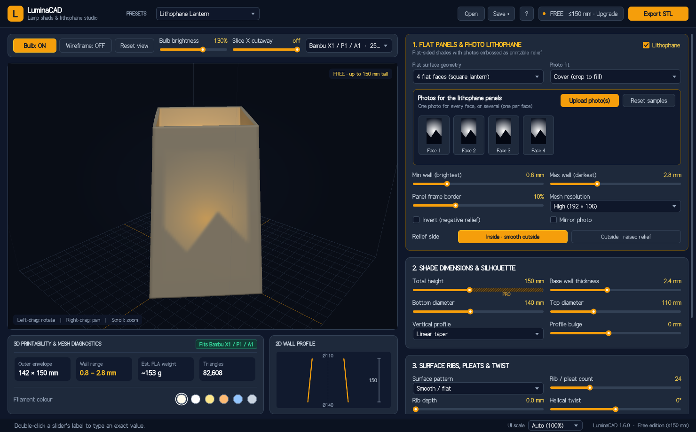
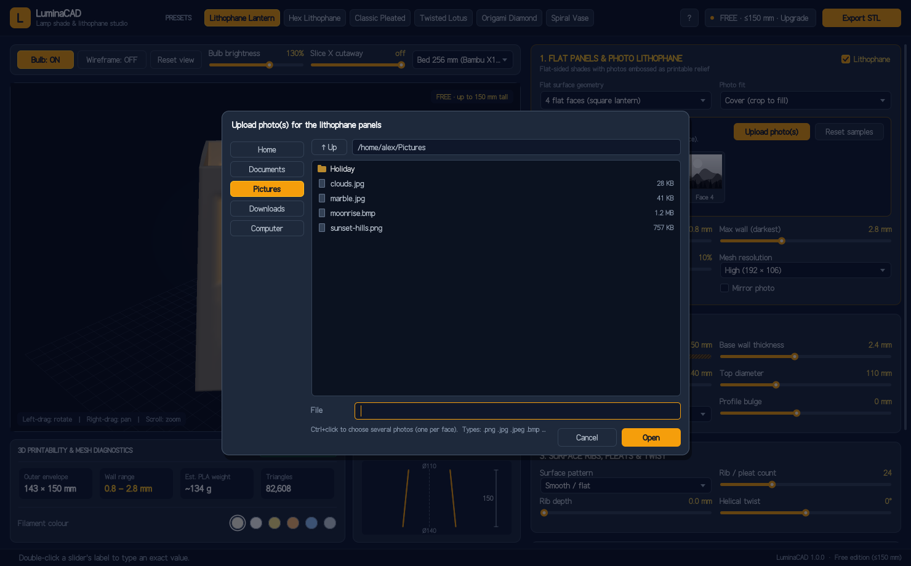
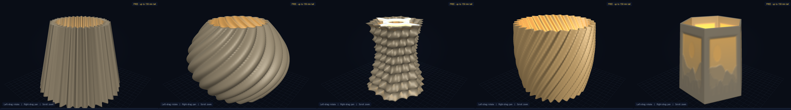
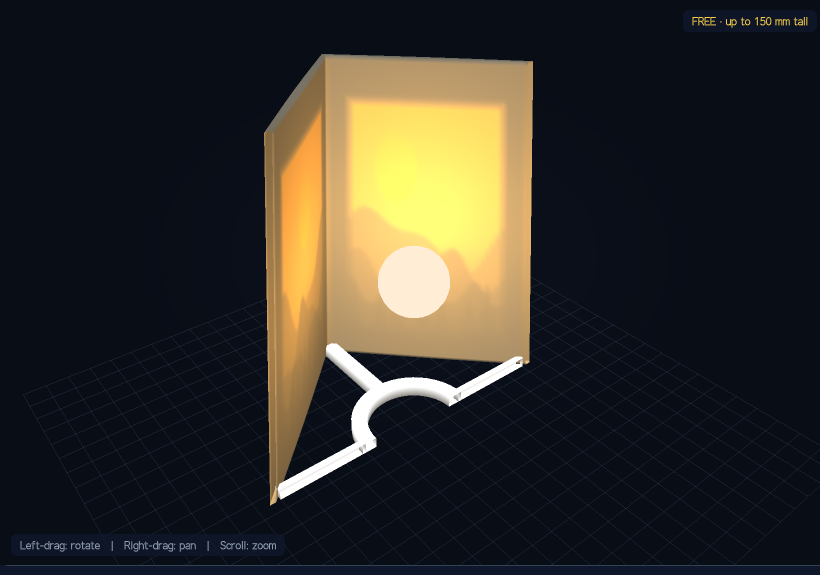
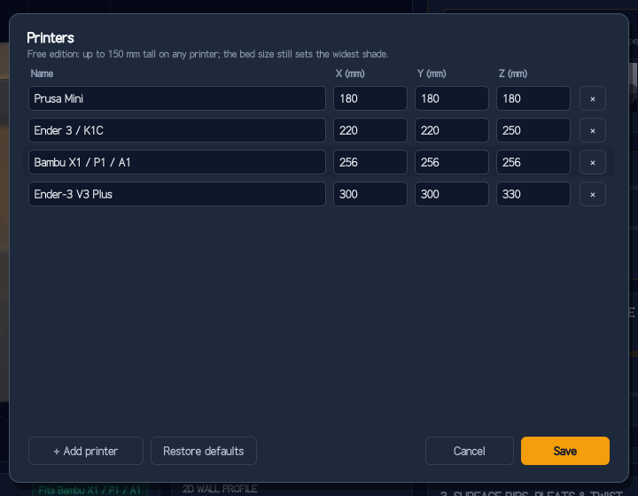
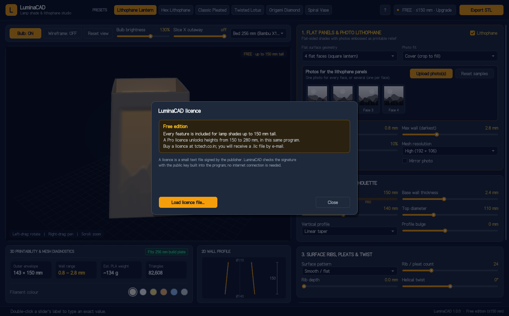
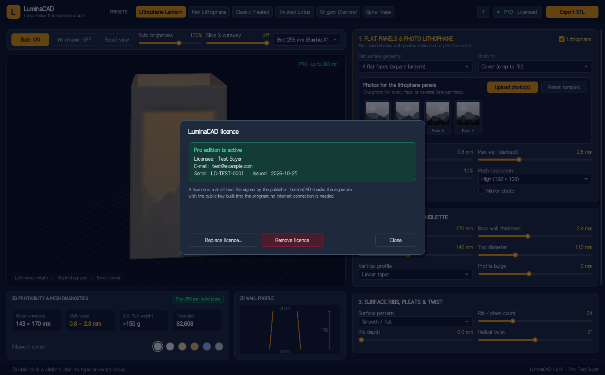
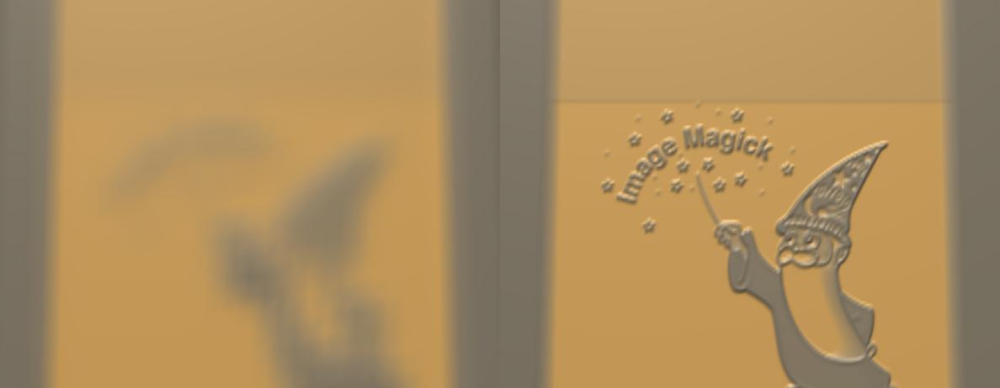

# LuminaCAD User Guide

**LuminaCAD 1.6** for Windows and Linux · Parametric 3D-printable lamp shade & lithophane designer · Guide revision 1.7, 26 October 2026



---

## Contents

**Part 1: Getting started**
1. What LuminaCAD is
2. Safety first
3. What you need
4. Installing LuminaCAD
5. A tour of the window
6. Your first lamp shade, step by step
7. Printing the shade

**Part 2: Everyday use**
8. Presets
9. Section 1: Flat panels & photo lithophane
10. Section 2: Shade dimensions & silhouette
11. Section 3: Surface ribs, pleats & twist
12. Section 4: Lamp socket ring (fitter)
13. The 3D view and its toolbar
14. Diagnostics and the 2D profile
15. Saving, opening and exporting

**Part 3: Free and Pro editions**
16. What the editions are
17. Buying and installing a Pro licence
18. Moving, backing up or removing a licence

**Part 4: Getting the best results**
19. Choosing and preparing photos
20. Lithophane tuning
21. Designing for the printer

**Part 5: Troubleshooting**
22. Problems and fixes
23. Messages explained
24. Self-test and diagnostics

**Part 6: Expert reference**
- A. Parameter reference
- B. Geometry in detail
- C. The STL file
- D. Command line
- E. Files and folders
- F. Licence file format
- G. Mouse and keyboard
- H. Glossary
- I. Design file format

---

# Part 1: Getting started

## 1. What LuminaCAD is

LuminaCAD designs lamp shades for 3D printing, on Windows and Linux. You choose a shape (round, or with 3 to 8 flat sides) and set its height and diameters. You can add ribs, pleats or a twist. A **lithophane** can also be pressed into the flat sides.

A lithophane is a photo made of thickness instead of ink. Where the plastic is thin, light from the bulb shines through brightly. Where it is thick, it shines through dimly. Switched off, the lamp looks like plain white plastic with a faint relief. Switched on, the photo appears.

LuminaCAD shows the shade in 3D as you change it, lit from inside by a virtual bulb, so you see roughly how the printed lamp will glow. When you are happy, you **export an STL file**. Your slicer (PrusaSlicer, Bambu Studio, OrcaSlicer, Cura and so on) turns that file into printer instructions.

LuminaCAD includes a **socket ring** (the "fitter" or "spider"): a ring with spokes that holds the shade on a standard E27 or E14 lamp holder.

## 2. Safety first

A lamp combines mains electricity, heat and plastic. Please read this before you light your first shade.

- **Use LED bulbs only.** PLA, the usual printing plastic, softens at about 55–60 °C. A filament (incandescent) or halogen bulb gets hot enough to warp or melt a PLA shade and is a fire risk. A household LED bulb of about 9 W or less (the "60 W equivalent" type) is the right choice.
- **Keep the bulb away from the wall.** Leave at least 25 mm between the bulb and the shade wall on every side. The 3D view shows the bulb as a 28 mm sphere at mid-height so you can check this. Use the Slice X cutaway (§13) to look inside.
- **Use a certified lamp holder and cable.** The printed part is only a shade. It must never carry or insulate mains wiring. Buy a complete, certified pendant or table-lamp fitting and fit the shade to it. Have mains wiring done by a qualified person.
- **PETG or ASA for warm places.** For enclosed fittings, warm rooms or long running times, print in PETG or ASA, which tolerate more heat than PLA.
- **Do not leave a new lamp unattended** the first few times it is used. Check after an hour that the shade is cool enough to touch comfortably near the bulb.

## 3. What you need

| Item | Notes |
|---|---|
| A computer | Windows 10 or 11 (64-bit), or Linux with a desktop (Ubuntu 22.04+, Debian 12+, Fedora 36+, Mint 21+; X11 or Wayland) |
| LuminaCAD | Free edition: download and run |
| A slicer | Any slicer that reads STL |
| A 3D printer | Any FDM printer; tell LuminaCAD its build volume (§13.1) |
| Filament | White or natural PLA for lithophanes; any colour for patterned shades |
| A lamp fitting | E27 or E14 holder with cord or pendant, certified for your country |
| An LED bulb | About 9 W or less (see §2) |

## 4. Installing LuminaCAD

Both downloads are on the **Releases** page of the LuminaCAD GitHub repository (github.com/rajivtctech/LuminaCAD). Windows and Linux run the same program, with the same features and the same licence files.

### 4.1 Windows 10 and 11

1. Download `luminacad-1.6.0-windows-x64.zip`.
2. Right-click the zip, choose **Extract All…**, and extract it somewhere permanent, for example `Documents\LuminaCAD`. Don't run it from inside the zip.
3. Open the extracted folder and double-click **luminacad.exe**.
4. The first time, Windows may show **"Windows protected your PC"**. This appears for any new program that is not yet widely downloaded. Click **More info**, then **Run anyway**. Windows remembers your choice.
5. *Optional:* make a desktop shortcut. Right-click `luminacad.exe` → **Show more options** → **Send to** → **Desktop (create shortcut)**. To pin it, right-click LuminaCAD's taskbar button while it is running and choose **Pin to taskbar**.

The folder also holds **luminacad-cli.exe**. It is the same program for the Command Prompt or PowerShell, used for the commands in Appendix D. For example:

```
luminacad-cli.exe --selftest
```

**To remove LuminaCAD:** delete the folder, and the shortcut if you made one. Your licence, if you installed one, stays in `%APPDATA%\LuminaCAD` until you delete that folder too.

### 4.2 Linux

1. Download `luminacad-1.6.0-linux-x86_64.tar.gz`.
2. Unpack it and run the installer. Open a terminal and type:

   ```
   tar xzf luminacad-1.6.0-linux-x86_64.tar.gz
   cd luminacad-1.6.0-linux-x86_64
   ./install.sh
   ```

   This copies the program to `~/.local/bin`, adds **LuminaCAD** to your application menu under **Graphics**, and runs the built-in self-test. It needs no administrator rights.
3. Start LuminaCAD from the menu, or by typing `luminacad` in a terminal.

The Linux version needs glibc 2.35 or newer: Ubuntu 22.04 and later, Debian 12, Fedora 36, Linux Mint 21 and their successors. It draws through X11. On a Wayland desktop (Ubuntu's default, KDE Plasma 6, GNOME) it runs through XWayland, which every mainstream Wayland desktop provides, so you need do nothing.

**To remove LuminaCAD:** run `./install.sh --remove` from the unpacked folder. Your licence stays in `~/.config/LuminaCAD` until you delete it.

### 4.3 Checking the download

Each download has a `.sha256` file beside it on the release page. To confirm a download is complete and unaltered:

- **Windows (PowerShell):**

  ```
  Get-FileHash luminacad-1.6.0-windows-x64.zip
  ```

  Compare the hash it prints with the one in the `.sha256` file.
- **Linux:** run the following in the folder that holds both files. It should print `OK`.

  ```
  sha256sum -c luminacad-1.6.0-linux-x86_64.tar.gz.sha256
  ```

### 4.4 Screen size and UI scale

**UI scale** enlarges everything in LuminaCAD (text, buttons, sliders and the 3D view) for high-resolution screens. LuminaCAD redraws at the screen's full resolution, so it stays sharp at any scale.

- **Auto** (the default) follows your desktop's display scaling: *Settings → Display → Scale* on Windows, or the display scale of KDE, GNOME and other Linux desktops. A laptop set to 150 % shows LuminaCAD at 150 %.
- To choose a size yourself, use the **UI scale** list at the bottom right of the window: 100 %, 125 %, 150 %, 175 %, 200 %, 250 % or 300 %.
- **Keyboard:** **Ctrl +** makes everything larger, **Ctrl −** smaller, and **Ctrl 0** goes back to Auto.
- Your choice is remembered next time.
- On Windows, moving the window to a monitor with a different scale adjusts it automatically.

LuminaCAD's layout needs at least 1000 × 620 units of space. If the window is too small for the scale you chose, LuminaCAD uses the largest scale that fits, and the label shows it in amber, for example **UI scale (124% fits)**. Make the window larger, or maximise it, to get the full scale.

On small screens (1024 × 768, 1366 × 768 at 100 %) LuminaCAD rearranges itself:
- the presets become a drop-down list;
- the view toolbar takes two rows;
- the settings column scrolls.

## 5. A tour of the window


**Header (top bar), left to right:**

- **LuminaCAD logo and name.**
- **Presets:** six ready-made designs. One click loads one; you can then change anything. See §8.
- **?:** the About box, with the version and edition.
- **Licence button:** shows `FREE · ≤150 mm · Upgrade` in the free edition and `PRO · Licensed` in Pro. Click it to see or install a licence.
- **Open / Save:** open a saved design, or save the current one as a `.lcad` design file (§15.1). **Save •** means there are unsaved changes.
- **Export STL:** saves the current design as an STL file for your slicer.

**Left column:**

- **View toolbar:** turn the bulb on or off, show the wireframe (the triangles the shape is made of), reset the view, set the bulb's brightness, cut the shade open with **Slice X cutaway**, and choose your **printer** (§13.1).
- **3D view:** drag with the left mouse button to turn the shade, drag with the right button to move the view up or down, and use the wheel to zoom. The badge at the top right shows your edition's height limit.
- **3D printability & mesh diagnostics:** the overall size, wall thickness, estimated weight of plastic, triangle count and whether the shade fits your bed. Below them are **filament colour** swatches, which change the preview colour only.
- **2D wall profile:** the shade's outline from the side, with its height and top and bottom diameters.

**Right column (scroll with the mouse wheel):**

1. **Flat panels & photo lithophane:** the number of flat sides, photos and lithophane settings.
2. **Shade dimensions & silhouette:** height, wall, diameters and side profile.
3. **Surface ribs, pleats & twist:** surface patterns.
4. **Lamp socket ring (fitter):** the ring that sits on the lamp holder.
5. **Edition card:** your edition, and the **Enter licence…** button in the free edition.

**Status bar (bottom):** messages appear here on the left, for example "Saved … (82,608 triangles)". Your version and edition are on the right.

## 6. Your first lamp shade, step by step

This walk-through makes a four-sided photo lantern with a different photo on each face.

1. **Start LuminaCAD.** It opens with the **Lithophane Lantern** preset: a four-sided lantern with sample mountain pictures.
2. **Look around.** Drag in the 3D view to turn the lantern. The panels glow warm where the plastic is thin.
3. **Choose your photos.** In section 1, click **Upload photo(s)**. A file window opens:

   

   - To use **one photo on every face**, click it and press **Open**.
   - To use a **different photo on each face**, hold **Ctrl** and click four photos, then press **Open**. They fill Face 1 to Face 4 in the order they are listed.
   - To change one face later, click its thumbnail (Face 1, Face 2 …) and pick a photo.
4. **Check the faces.** The thumbnails show the part of each photo that will be used. If heads are cut off, change **Photo fit** to **Contain whole photo** (§9.2).
5. **Set the size.** In section 2, drag **Total height**, or **double-click the words "Total height"** and type a number, then press Enter. The free edition goes up to 150 mm. Set the bottom and top diameters the same way.
6. **Choose the socket.** In section 4, click **E27 40.5** for a standard large screw bulb holder, or **E14 28.5** for a small one. Measure your holder if unsure: the hole must slip over the threaded part (§12).
7. **Check the fit.** Choose your printer in the toolbar's printer list (§13.1). In the diagnostics, the badge should say **Fits** followed by your printer's name. If it says **Too big for …**, reduce the diameters, rib depth or bulge.
8. **Export.** Click **Export STL** (top right), choose a folder, keep or change the name, and press **Save**.
9. **Print it**, as described next.

## 7. Printing the shade

### 7.1 Lithophane shades

| Slicer setting | Recommended | Why |
|---|---|---|
| Filament | White or natural PLA (PETG for warmth) | Light must pass through evenly |
| Layer height | 0.12–0.16 mm | Finer layers give smoother shading |
| Infill | **100 %** | Any gap shows as a dark speck in the picture |
| Walls / perimeters | 3 or more | With 100 % infill the walls are solid anyway |
| Orientation | Upright, as exported (bottom ring on the bed) | Layers run around the shade, so the picture keeps its detail |
| Supports | Off | The shapes are designed to print without them |
| Seam | Aligned or rear | Keeps the seam on one corner |
| Speed | Slow outer walls (≤ 40 mm/s) | Cleaner surface |

### 7.2 Patterned shades without photos

Use 2–3 walls and 15–20 % infill. The **Spiral Vase** preset has no fitter and a thin 1.2 mm wall, made for your slicer's *spiral vase* (or *vase mode*) setting. In vase mode the slicer prints only the outside skin as one continuous spiral.

### 7.3 Fitting the shade

The socket ring is part of the shade, so there is nothing to glue. Unscrew the lamp holder's shade ring, drop the shade's ring over the threaded sleeve, and screw the shade ring back on to clamp it.

---

# Part 2: Everyday use

## 8. Presets

| Preset | What it is | Notable settings |
|---|---|---|
| **Lithophane Lantern** | Four flat photo panels, tapered | 4 faces, 170 mm (150 mm in Free), Ø140 → Ø110, bottom spider |
| **Hex Lithophane** | Six photo panels | 6 faces, 175 mm (150 in Free), Ø160 → Ø130 |
| **Classic Pleated** | Accordion-pleated round shade | 36 pleats 6.5 mm deep, Ø180 → Ø110, 165 mm (150 in Free) |
| **Twisted Lotus** | Bulging round shade with twisted flutes | Bulbous profile, 20 scallops, 95° twist |
| **Origami Diamond** | Six-sided hourglass with diamond facets | Origami pattern, 30° twist, top pendant spider |
| **Spiral Vase** | Tulip-shaped, ribbed, open | Sine ribs, 60° twist, 1.2 mm wall, no fitter |



A preset changes only the settings listed for it; anything else you set stays as it was. In the free edition, presets designed taller than 150 mm are built at 150 mm, and the status bar says so.

## 9. Section 1: Flat panels & photo lithophane

### 9.1 Flat surface geometry

| Choice | Result |
|---|---|
| Round (no flat faces) | A round shade. A lithophane wraps all the way round as one 360° picture. |
| 3, 4, 5, 6 or 8 flat faces | A lantern with that many flat panels. Each panel takes its own photo. |

The faces are truly flat between the corners, which is what you want for a lithophane: the picture is not curved.

### 9.2 Photo fit

| Choice | What happens | Use when |
|---|---|---|
| **Cover (crop to fill)** | The photo fills the panel; edges that don't fit are cut off | Most photos |
| **Contain whole photo** | The whole photo is shown; empty areas become light grey (thin, bright plastic) | Everything in the picture must show |
| **Stretch to panel** | The photo is squashed to fit exactly | Patterns and textures where distortion doesn't matter |

### 9.3 Photos and slots

- **Upload photo(s):** one photo is used on every face. Several photos (Ctrl+click) fill faces 1, 2, 3 … in order.
- **Click a face thumbnail** to replace that face's photo only.
- **Reset samples** brings back the built-in mountain pictures.
- **Lithophane** (tick box, top right of the section): untick it for a plain shade of even thickness. Your photos are kept.

### 9.4 Lithophane settings

| Setting | Meaning |
|---|---|
| **Min wall (brightest)** | Plastic thickness where the photo is white. Thinner gives brighter highlights but a more fragile wall. 0.8 mm is a good start. |
| **Max wall (darkest)** | Thickness where the photo is black. Thicker gives deeper shadows. 2.8 mm is a good start. |
| **Panel frame border** | A solid frame around each picture, as a percentage of the panel. It strengthens the panel and its edges. |
| **Mesh resolution** | How finely the shape is divided. **Draft**, **High** and **Ultra** use a fixed number of points whatever the size: good for everyday shades. The **detail modes** (**Fine · 1 mm**, **Extra fine · 0.5 mm**, **Ultra fine · 0.3 mm**) space the points by millimetres, so large shades get as much lithophane detail as small ones (§20.1). |
| **Invert (negative relief)** | Swaps thick and thin, for a photo-negative effect. |
| **Mirror photo** | Flips each photo left to right, for example to correct a mirrored scan or text. |
| **Relief side** | Where the thickness changes. **Inside · smooth outside** (the default) keeps the outer surface smooth: switched off, the lamp looks like a plain shade and is easy to dust. **Outside · raised relief** shows the picture as a relief you can see and touch even when the lamp is off. Lit, both look the same. |

## 10. Section 2: Shade dimensions & silhouette

| Setting | Meaning |
|---|---|
| **Total height** | From 70 mm up to your printer's Z height (Pro), or up to 150 mm (Free). In the free edition the part of the slider above 150 mm is hatched and marked **PRO**. |
| **Base wall thickness** | Thickness of the wall where there is no lithophane (and of the whole wall when the lithophane is off). |
| **Bottom / top diameter** | Across the shade, at the bottom and top, measured to the corners on a flat-sided shade. Up to the smaller of your printer's X and Y. |
| **Vertical profile** | The side outline: **Linear taper** (straight), **Classic bell**, **Hourglass waist**, **Bulbous lantern**, **Tulip blossom**, **Pagoda tiered**. Watch the 2D profile change. |
| **Profile bulge** | How strongly the profile curves outward (positive) or inward (negative). |

For a lithophane, keep **Linear taper** with **bulge 0**, so the panels stay flat from top to bottom.

## 11. Section 3: Surface ribs, pleats & twist

| Setting | Meaning |
|---|---|
| **Surface pattern** | **Smooth / flat**, **Sinusoidal ribs** (soft waves), **Accordion pleats** (sharp folds), **Fluted scallops** (rounded flutes), **Origami facets** (diamond pattern). |
| **Rib / pleat count** | Number of ribs round the shade (4–72). |
| **Rib depth** | How far the ribs stand out, in mm. 0 switches the pattern off. |
| **Helical twist** | Rotates the pattern from bottom to top, up to ±180°, giving a spiral look. |

Patterns and lithophanes can be combined, but a photo on a ribbed panel is hard to read. Patterns look best on round shades.

## 12. Section 4: Lamp socket ring (fitter)

| Setting | Meaning |
|---|---|
| **E27 40.5 / E14 28.5 / Harp 11** | Quick choices for the hole size: E27 (large Edison screw), E14 (small Edison screw), and a harp or threaded-rod fitting. |
| **Fitter placement** | **Bottom socket spider** for table lamps with the bulb pointing up. **Top pendant spider** for ceiling pendants. **Recessed spider** sits 25 mm below the top, hiding the holder. **None** gives an open shade or vase. |
| **Socket hole diameter** | The hole in the ring. Measure your lamp holder's threaded sleeve and add about 0.5 mm. |
| **Support spokes** | 3 to 6 arms from the ring to the wall. |
| **Ring & spoke height** | Thickness of the ring and spokes. 5 mm is strong enough for most shades; use 6–8 mm for heavy or tall shades. |

## 13. The 3D view and its toolbar

| Control | Action |
|---|---|
| Left-drag in the view | Turn the shade round and tilt the view |
| Right-drag (or Shift + left-drag) | Move the view up and down |
| Mouse wheel | Zoom in and out |
| **Reset view** | Back to the starting view |
| **Bulb: ON / OFF** | Lights the shade from inside or shows it unlit |
| **Bulb brightness** | Brighter or dimmer virtual bulb (preview only) |
| **Wireframe** | Shows the triangles that make the shape |
| **Slice X cutaway** | Cuts the shade open so you can see the wall thickness, the bulb and the spider. Slide fully right to switch it off. |
| **Printer list** | Your printer: sets the size limits, the bed grid and the build-volume box, and the "Fits" check (§13.1) |



The picture sharpens a moment after you stop dragging. While you drag, LuminaCAD draws a quicker preview so it stays smooth.

### 13.1 Printers

LuminaCAD needs to know your printer's **build volume**: how far it prints across (X), front to back (Y) and up (Z). The printer you choose:

- **sets the size limits.** Heights go up to its Z (in the free edition, up to 150 mm at most). Diameters go up to the smaller of X and Y, because a round shade must fit both ways.
- **draws its bed** in the 3D view, with a faint box showing the full build volume;
- **sets the "Fits" check** in the diagnostics.

**Choosing a printer.** Click the printer list in the view toolbar (it shows the name and X × Y × Z) and pick one. LuminaCAD starts with four common printers: Prusa Mini, Ender 3 / K1C, Bambu X1 / P1 / A1 and Ender-3 V3 Plus.

**Adding your printers.** Choose **Manage printers…** at the bottom of the list:



1. Click **+ Add printer**, type a name (for example *Modix BIG-60* or *Workshop Voron*), press **Tab**, and type the X, Y and Z build sizes in millimetres. Your printer's specification sheet lists them as *build volume* or *print size*.
2. Edit any row the same way. Clicking or tabbing into a field and typing replaces what is there.
3. **×** deletes a printer. **Restore defaults** brings back the four standard printers.
4. Click **Save**.

- **Limits.** Sizes can be from 60 mm (X, Y) or 70 mm (Z) up to 2000 mm. Names must be unique.
- **Where they are kept.** Your printers are remembered in `settings.ini`.
- **Designs.** A saved design records which printer it was made for, and opening it selects that printer again if you have it.

**Very large shades (Pro).** With a large-format printer, LuminaCAD makes shades up to its full build volume:
- the grid spacing grows to 50 or 100 mm;
- **Reset view** frames the whole shade;
- the cut-away and zoom range scale with it.

For lithophanes on large shades, choose a **detail mode** (§20.1); the fixed grids spread the same number of points over the whole shade, so a large lithophane would look soft.

## 14. Diagnostics and the 2D profile

| Reading | Meaning |
|---|---|
| **Outer envelope** | Widest diameter × height, in mm. This is the space the shade needs on the bed. |
| **Wall range** | Thinnest to thickest wall (with the lithophane on), or the single wall thickness. |
| **Est. PLA weight** | Plastic needed at 100 % infill, from the exact volume of the shape. With less infill it will use less. |
| **Triangles** | Size of the 3D model. Most slicers handle a million or more. |
| **Fits / Too big for** | Green when the shade fits the printer chosen in the toolbar (widest point within X and Y, height within Z), red when not. |

## 15. Saving, opening and exporting

### 15.1 Saving and opening designs

A **design file** (`.lcad`) keeps everything about a lamp shade so you can come back to it later:
- the shape, pattern, lithophane and socket settings;
- the filament colour;
- **your photos**, stored inside the file, so the design stays complete even if you move or delete the originals.

| To | Do |
|---|---|
| Save | Click **Save** (top right) or press **Ctrl S**. The first time, choose a folder and a name; afterwards Save updates the same file. |
| Save under a new name | **Ctrl Shift S** |
| Open | Click **Open** or press **Ctrl O**, then pick a `.lcad` file. |
| Open from your desktop | Double-click a `.lcad` file. On Linux this works after `./install.sh`. On Windows, switch it on once: click **?** (top right) → **Open .lcad files with LuminaCAD** (§15.3). |

The window title shows the design's name. A **•** before it (and **Save •**) means there are changes you have not saved. If you close LuminaCAD or open another design with unsaved changes, it asks whether to save them: **Save**, **Don't save**, or **Cancel**.

- **Sharing.** A design is one file: e-mail it, or keep it with your other projects. Anyone with LuminaCAD can open it.
- **Free and Pro.** Both editions open every design. A design made taller than 150 mm in Pro opens in the free edition at 150 mm, and the status bar says so. If you then save it from the free edition, it is saved at 150 mm.
- **File size.**
  - Each photo is stored once, even if it is used on several faces, at up to 2048 pixels on its longest side, enough for the finest detail mode on large shades.
  - A design with the sample pictures is under 1 KB; one with photos is typically 1–5 MB per photo.
- **Damaged files.** If a photo inside a design is damaged, LuminaCAD opens the rest of the design, puts a sample picture on that face, and tells you.

### 15.2 Exporting the STL

Click **Export STL**. In the save window:

- Choose a folder from the list on the left (Home, Documents …) or double-click folders.
- Type a name; `.stl` is added if you leave it off.
- If the file already exists, LuminaCAD asks you to press **Replace** to confirm.

The status bar then reports the file name and triangle count. The STL is in millimetres, standing upright on the bed, ready for the slicer.


### 15.3 Opening designs by double-clicking (Windows)

The Windows version is a portable folder with no installer, so it does not take over `.lcad` files until you ask it to:

1. Start LuminaCAD and click **?** (top right).
2. Click **Open .lcad files with LuminaCAD**.

From then on, `.lcad` files show the LuminaCAD design icon in File Explorer, and double-clicking one opens it in LuminaCAD.

- **For your account only.** The setting applies to your Windows account and needs no administrator rights.
- **Moving the folder.** If you move the LuminaCAD folder later, the link follows: the next time you start LuminaCAD from its new place, it updates itself.
- **Turning it off.** Click **?** → **Stop opening .lcad files**.
- **Command line.** The same is available as `luminacad-cli.exe --register-file-type` and `--unregister-file-type`.

If you have already chosen another program for `.lcad` files through Windows' own "Open with → Always" setting, Windows keeps your choice. Pick LuminaCAD there instead: right-click the file → **Open with** → **Choose another app**.

On Linux, `./install.sh` sets this up automatically.

---

# Part 3: Free and Pro editions

## 16. What the editions are

| | Free | Pro |
|---|---|---|
| Price | Free | Paid licence |
| Shade size | up to **150 mm** tall | as large as your printer: up to its **Z** height and the smaller of its **X** and **Y**, up to 2000 mm |
| All shapes, patterns, lithophanes, fitters, presets, export | ✓ | ✓ |
| Program | Same | Same, with a licence file loaded |

There is only one program. The Pro edition is the free program with a licence file installed. You never reinstall.

## 17. Buying and installing a Pro licence

1. Buy a Pro licence (see **?** → About, or the edition card, for where). You receive a small file named like `LC-2026-0001.lic` by e-mail.
2. Save the file anywhere, for example in Downloads.
3. In LuminaCAD, click the **FREE · ≤150 mm · Upgrade** button (top right), or **Enter licence…** at the bottom of the right column.

   

4. Click **Load licence file…**, select the `.lic` file and press **Open**.
5. The window turns green and shows your name and serial. The height slider now goes to your printer's full Z height.

   

No internet connection is needed: the licence is checked inside the program.

From a terminal, the same is done with:

```
luminacad --install-license ~/Downloads/LC-2026-0001.lic                   (Linux)
luminacad-cli.exe --install-license %USERPROFILE%\Downloads\LC-2026-0001.lic   (Windows)
luminacad --license-status
```

## 18. Moving, backing up or removing a licence

- **Back up** the `.lic` file you received, with your other important documents.
- **New computer:** install LuminaCAD and load the same `.lic` file. The same licence file works on Windows and on Linux.
- **Remove:** open the licence window and click **Remove licence**, or run `luminacad --remove-license`. LuminaCAD returns to the free edition. Designs taller than 150 mm are brought back to 150 mm.
- **Never edit the licence file.** Changing even one letter, or a space, makes it invalid. If you have edited it, use the original from the e-mail.

---

# Part 4: Getting the best results

## 19. Choosing and preparing photos

- **Good photos:** strong contrast, a clear subject, not too much fine detail. Portraits, pets, landscapes with a bright sky, silhouettes and architecture work well.
- **Difficult photos:** very dark photos (the panel becomes thick and dim), very busy photos, and small text.
- **Shape:** the panels are taller than they are wide on most lanterns. Portrait-format photos usually fill them best with **Cover**.
- **Formats:** PNG, JPEG, BMP and PPM/PGM. A phone's sideways photo is turned upright automatically (EXIF orientation).
- **Not supported:** CMYK JPEGs from print workflows, and arithmetic-coded JPEGs. Re-save them as ordinary RGB JPEG or PNG in any image editor.
- **Resolution:** each panel uses a 128 × 128 grid. Large photos are fine: they are reduced on loading.

## 20. Lithophane tuning

| Want | Change |
|---|---|
| Brighter highlights | Lower **Min wall** (no less than 0.6 mm on most printers) |
| Deeper shadows, more contrast | Raise **Max wall** (3.0–3.5 mm) |
| More detail | A **detail mode** (§20.1), and print at 0.12 mm layers |
| Less fragile panels | Raise **Min wall** to 1.0 mm and the **Panel frame border** to 12–15 % |
| A picture that reads correctly from outside | Leave **Mirror photo** off. LuminaCAD lays photos out to read correctly from outside, whichever side the relief is on. |
| A plain-looking shade when switched off | **Relief side: Inside** (the default) |
| A visible relief when switched off | **Relief side: Outside** |

Turn **Bulb: ON** and lower the **Bulb brightness** to judge the picture as it will look in a dim room.

### 20.1 Detail modes for large shades

The **Mesh resolution** list (section 1 of the settings) has three detail modes besides Draft, High and Ultra:

| Mode | Point spacing | Use for |
|---|---|---|
| **Fine · 1 mm** | 1 mm | Large shades, and lithophanes viewed from a distance |
| **Extra fine · 0.5 mm** | 0.5 mm | Large lithophanes viewed close up |
| **Ultra fine · 0.3 mm** | 0.3 mm | Small lithophanes with very fine detail (print at 0.12 mm layers with a 0.4 mm nozzle) |

The fixed grids divide every shade into the same number of points. A 150 mm lantern gets a point about every 1–2 mm, but a 1.2 m shade only every 10 mm or so, which blurs a lithophane. The detail modes keep the spacing the same at any size:



*The same panel of a 1.2 m hexagonal lithophane: High (left) and Extra fine (right).*

- **The 3D view stays quick.** It shows a lighter version of the shade (up to 250 000 triangles). The full detail is built when you export, while a "Building the detailed mesh…" notice shows; even very large shades take only a few seconds.
- **Triangle count.** In a detail mode the diagnostics show **Export triangles** and the spacing the STL will have, for example *1.2 M · 0.5 mm*.
- **Size limit.** An STL is limited to 6 million triangles (about 300 MB), which slicers handle comfortably. On very large shades the finest modes reach that limit. The panel then shows **Export (capped)** in amber with the spacing actually achieved, and the export message says so. A coarser mode then gives the same result faster.
- **Photo detail.** Photos are kept at up to 2048 pixels on their longest side. For the sharpest large lithophanes, use photos at least that size.
- **Photo proportions.** Each face's relief has the panel's real proportions, so photos are never stretched to fit; **Photo fit** decides how the photo meets the panel's shape.

## 21. Designing for the printer

- **Overhangs:** most printers manage outward slopes up to about 45° without support. Very strong **Bulbous** or **Pagoda** profiles with large bulge values can exceed that near the bottom.
- **Thin walls:** keep the wall at least two nozzle widths thick (0.8 mm for a 0.4 mm nozzle).
- **Tall shades** (Pro): print slowly near the top and use a brim if the base is narrow.
- **Printer size:** check the **Fits** badge. If a shade is too wide, reduce the diameters, or the rib depth on ribbed shades.

---

# Part 5: Troubleshooting

## 22. Problems and fixes

| Problem | Cause and fix |
|---|---|
| Windows: "Windows protected your PC" | Click **More info**, then **Run anyway** (§4.1). |
| Windows: nothing happens when starting it from inside the zip | Extract the zip first, then run `luminacad.exe` from the extracted folder. |
| Windows: a command such as `luminacad.exe --selftest` prints nothing | Use `luminacad-cli.exe` for commands; `luminacad.exe` is the windowed program. |
| Linux: LuminaCAD doesn't start; the terminal says "cannot open the X display" | It was started without a desktop (for example over SSH). Start it from the desktop, or use `ssh -X`. |
| Linux: "needs a 24-bit TrueColor display" | Very old or remote display settings. Use a normal desktop session. |
| The height slider stops at 150 mm | This is the free edition's limit. See Part 3. |
| "Preset height … reduced to 150 mm" | The preset was designed taller; the free edition builds it at 150 mm. |
| A photo won't load | See the message in §23. Re-save the photo as PNG or RGB JPEG. |
| The photo is upside down or sideways | Some editors strip the orientation tag. Rotate the photo in an editor and save it again. |
| The picture is too dark when printed | Use a brighter photo, lower **Max wall**, or use whiter filament. |
| The picture is faint | Raise **Max wall**; print at 100 % infill; use a brighter bulb. |
| Dark specks in the printed picture | Infill below 100 %, or gaps between walls. Use 100 % infill. |
| "Too big for …" | Choose the right printer in the toolbar; then reduce the diameters, rib depth, bulge or height. |
| "Height … reduced to … mm: <printer> prints up to that height" | The design is taller than the printer you chose. Choose a larger printer, or add yours (§13.1). |
| The 3D view is slow | Use **Mesh resolution: High** or **Draft** while designing, and switch to Ultra before exporting. At large UI scales the view has more pixels to draw: maximise only when needed, or lower the UI scale. |
| Windows: double-clicking a `.lcad` file does not open LuminaCAD | Switch it on: **?** → **Open .lcad files with LuminaCAD** (§15.3). If it is on but another program still opens them, Windows is keeping an earlier "Always" choice: right-click → **Open with** → **Choose another app** → LuminaCAD. |
| Everything is too small or too large | Use the **UI scale** list (bottom right) or **Ctrl + / Ctrl −** (§4.4). |
| The UI scale label is amber, "… fits" | The window is too small for the chosen scale; enlarge or maximise it (§4.4). |
| The ring doesn't fit the lamp holder | Measure the threaded sleeve and set **Socket hole diameter** to that plus 0.5 mm. |

## 23. Messages explained

| Message | Meaning |
|---|---|
| Free edition: lamp shades up to 150 mm tall… | You tried to go above the free limit. |
| Export refused: this shade is … mm tall; the free edition exports up to 150 mm | A last safety check; should not normally appear. |
| Could not load the photo. … not a PNG, JPEG, BMP or PPM image | The file is another format (HEIC, WebP, TIFF …). Convert it. |
| … lossless or arithmetic-coded JPEG is not supported | A rare JPEG type. Re-save as a normal JPEG. |
| … unsupported JPEG (needs 1 or 3 colour components) | A CMYK JPEG. Re-save as RGB. |
| … corrupt compressed data / truncated | The file is damaged or incompletely downloaded. |
| Licence not accepted: licence signature does not match | The file was edited, damaged, or is not a LuminaCAD licence. Use the original file. |
| Licence not accepted: not a LuminaCAD licence file | A different file was chosen. |
| Licence is valid but could not be saved | The settings folder is not writable; check `~/.config`. |

## 24. Self-test and diagnostics

Run `luminacad --selftest` in a terminal (on Windows: `luminacad-cli.exe --selftest` in the Command Prompt or PowerShell, from the LuminaCAD folder). It checks:

- the signature code against the official test values;
- that unsigned or altered licences are refused;
- the free height limit, at both the settings and the export stage;
- that every shape option produces a closed (watertight) shell;
- the image decoder.

It ends with `self-test: all checks passed`. If you report a problem, include that line and the output of `luminacad --version` and `luminacad --license-status`.

---

# Part 6: Expert reference

## A. Parameter reference

| Parameter | Range | Step | Default |
|---|---|---|---|
| Total height | 70–150 mm (Free); 70 mm to the printer's Z (Pro) | 1 | 150 |
| Base wall | 0.8–4.5 mm | 0.1 | 2.4 |
| Bottom diameter | 50 mm to the smaller of the printer's X and Y | 2 | 140 |
| Top diameter | 40 mm to the smaller of the printer's X and Y | 2 | 110 |
| Profile bulge | −40 to 50 mm | 1 | 0 |
| Rib count | 4–72 | 1 | 24 |
| Rib depth | 0–18 mm | 0.5 | 0 |
| Twist | −180° to 180° | 5 | 0 |
| Min wall | 0.4–2.0 mm | 0.1 | 0.8 |
| Max wall | 1.6–5.0 mm | 0.1 | 2.8 |
| Frame border | 3–25 % | 1 | 10 |
| Mesh resolution | Draft / High / Ultra, or detail 1 / 0.5 / 0.3 mm | | High |
| Relief side | Inside (smooth outside) / Outside | | Inside |
| Socket hole | 10–65 mm | 0.5 | 40.5 |
| Spokes | 3–6 | 1 | 4 |
| Ring height | 3–12 mm | 0.5 | 5 |
| Bulb brightness (view) | 0–200 % | 1 | 130 |
| Slice X (view) | across the shade; fully right = off | 1 | off |

Slider steps apply when dragging. A typed value is used as typed (within the range), so you can enter, say, 123.5 mm.

## B. Geometry in detail

### B.1 Coordinates

In the program the shade stands on the Y axis (Y up), from y = 0 to y = height. Radii are measured from the axis. On export, Y becomes Z.

### B.2 Profile

With v = y / height, r_b = bottom diameter / 2 and r_t = top diameter / 2, the base radius is r = r_b + (r_t − r_b)·v, plus:

| Profile | Added term |
|---|---|
| Linear | bulge · sin(πv) |
| Bell | sin(πv) · (bulge − 10·cos(πv)) |
| Hourglass | −sin(πv) · (20 − bulge/2) |
| Bulbous | sin(πv) · (24 + bulge) |
| Tulip | 18·sin(0.85πv) + 14·v³ |
| Pagoda | 6·sin(3πv) + bulge·sin(πv) |

The result is never less than 15 mm.

### B.3 Flat faces

For n faces, a point at angle θ lies in sector k = ⌊θ / (2π/n)⌋. With half-sector α = π/n and local angle φ = θ − k·2π/n, the radius is multiplied by cos α / cos(φ − α). This makes each face a straight chord: the corners lie at the profile radius, and face centres sit at cos α of it.

The lithophane's horizontal coordinate on a face is u = ½ + tan(φ − α) / (2·tan α). This is linear along the flat face, so the photo is not distorted.

### B.4 Patterns

With phase p = (2πu + twist·v)·ribs, where u is the angle fraction round the shade and twist is in radians, the radial offset is:

| Pattern | Offset |
|---|---|
| Sine | depth · sin p |
| Pleats | depth · tri(p), where tri is a triangle wave from −1 to 1 |
| Scallop | depth · \|sin(p/2)\| |
| Origami | depth · tri(p/2 + 8πv) · tri(p/2 − 8πv) |

### B.5 Wall and lithophane

- **Inner and outer radius.** Let mid = profile · face factor + pattern offset (the wall's centre line).
  - **Relief inside** (default): outer = mid + base wall/2 and inner = outer − local wall, so the outside is smooth.
  - **Relief outside:** inner = max(8, mid − base wall/2) and outer = inner + local wall.
  - A plain wall (local wall = base wall) is the same either way.
- **Local wall.** In the frame border it is max(base wall, max wall). Inside the picture it is min + (1 − L)·(max − min), where L is the luminance (0–1) sampled bilinearly from the face's relief map (§B.6). With Invert, it uses L instead of (1 − L). Within 4 % of the picture edge it blends linearly towards max wall.

### B.6 Mesh

- **Fixed grids** (Draft, High, Ultra). There are segV = round(0.55·R) rings of segU columns, where R is 120, 192 or 264. For a round shade segU = R; for n faces it is R rounded up to a multiple of n.
- **Detail modes.** segU = ⌈widest circumference / spacing⌉ (a multiple of n on flat-sided shades) and segV = ⌈height / spacing⌉.
  - If that would exceed the triangle budget, both shrink by the same factor: 250 000 triangles for the 3D view and 6 000 000 for the STL.
  - The **relief map** for each face has the panel's own proportions (width at mid-height × height, inside the frame). It is 128 px on its long side for the fixed grids, or one pixel per detail step (at most 4096) in the detail modes.
- **Vertices.** Each grid point has an outer and an inner vertex. The columns wrap round, so the seam is closed. The top and bottom rims join the inner and outer walls.
- **Triangles.** The count is 4·segU·segV + 4·segU, plus 384 for the ring and 12 per spoke.

## C. The STL file

| Property | Value |
|---|---|
| Format | Binary STL, little-endian, 50 bytes per triangle |
| Units | Millimetres |
| Axes | Z up; the shade stands on Z = 0, centred on X = Y = 0 |
| Header | `LuminaCAD binary STL (mm, Z up)` |
| Normals | Per facet, pointing out of the solid |
| Bodies | The shade is one closed shell. The ring and each spoke are further closed bodies overlapping it; slicers merge them. |

## D. Command line

On Windows use `luminacad-cli.exe` in place of `luminacad` for every command below. `luminacad.exe` is the windowed program and has no console of its own.

```
luminacad [DESIGN.lcad]                      open the designer (and a design)
luminacad --open DESIGN.lcad ...             start from a saved design (with --export-stl or --screenshot)
luminacad --save-design OUT.lcad [options]   build a design from a preset/photos and save it
luminacad --export-stl OUT.stl [options]     export without opening a window
    --preset lithophane|hex-litho|pleated|lotus|origami|vase
    --height MM                              limited to the edition and printer maximum
    --detail MM                              detail mode spacing (1, 0.5, 0.3); 0 = fixed grid
    --relief inside|outside                  which side of the wall carries the lithophane relief
    --printer NAME                           use one of your printer profiles
    --build-volume X,Y,Z                     use this build volume for this run only
    --photo FILE [FILE ...]                  one photo for all faces, or one per face
luminacad --printers                         list the printer profiles (* = selected)
luminacad --register-file-type               Windows: open .lcad files with LuminaCAD (your account)
luminacad --unregister-file-type             Windows: remove that
luminacad --install-license FILE.lic
luminacad --remove-license
luminacad --license-status
luminacad --selftest
luminacad --screenshot OUT.ppm [--size WxH] [--preset P] [--height MM]
          [--orbit THETA,PHI,RADIUS] [--slice X] [--dialog license|about|photos]
luminacad --version | --help
```

Exit codes: 0 success; 1 failure (bad photo, licence refused, self-test failed); 2 export refused; 64 bad command line.

Example (batch export of a photo lantern):

```
luminacad --export-stl lantern.stl --preset lithophane --height 140 --photo a.jpg b.jpg c.jpg d.jpg
```

## E. Files and folders

| What | Where |
|---|---|
| Program (Windows) | Wherever you extracted the zip: `luminacad.exe`, `luminacad-cli.exe` |
| Installed licence (Windows) | `%APPDATA%\LuminaCAD\license.lic` (usually `C:\Users\<you>\AppData\Roaming\LuminaCAD`) |
| Program (Linux) | `~/.local/bin/luminacad` (after `./install.sh`) |
| Menu entry, icon (Linux) | `~/.local/share/applications/luminacad.desktop`, `~/.local/share/icons/hicolor/scalable/apps/luminacad.svg` |
| Installed licence (Linux) | `~/.config/LuminaCAD/license.lic` (or `$XDG_CONFIG_HOME/LuminaCAD/`) |
| Settings (UI scale, printers) | `settings.ini` in the same folder as the licence |
| Designs | `.lcad` files wherever you save them (§15.1); the save window starts in Documents |
| `.lcad` association (Windows) | `HKEY_CURRENT_USER\Software\Classes\.lcad` and `…\LuminaCAD.Design`, when switched on (§15.3) |

## F. Licence file format

A licence is UTF-8 text with one `key=value` per line:

| Key | Content |
|---|---|
| `product` | `LuminaCAD` |
| `edition` | `Pro` |
| `licensee` | Buyer's name |
| `email` | Buyer's e-mail |
| `serial` | `LC-YYYY-NNNN` |
| `issued` | Date, YYYY-MM-DD |
| `signature` | 128 hexadecimal digits (64 bytes) |

- **Signature.** An Ed25519 signature (RFC 8032) over every line except `signature`, in file order, each as `key=value` followed by a newline. Leading and trailing spaces are trimmed. Lines starting with `#` are comments and are not signed.
- **Verification.** LuminaCAD holds the publisher's public key and verifies offline. It accepts the licence only if the signature verifies, the product is LuminaCAD and the edition is Pro.

## G. Mouse and keyboard

| Input | Action |
|---|---|
| Left-drag in the 3D view | Orbit |
| Right-drag, or Shift + left-drag | Move the view up and down |
| Wheel over the 3D view | Zoom |
| Wheel over the right column | Scroll the settings |
| Wheel over an open list | Scroll the list |
| Double-click a slider's label | Type an exact value; the typing replaces the old value |
| Enter / Tab | Apply a typed value |
| Esc | Cancel typing; close a list, dialog or the file window |
| Ctrl O | Open a design |
| Ctrl S / Ctrl Shift S | Save the design / save under a new name |
| Ctrl + / Ctrl − | Larger / smaller UI scale |
| Ctrl 0 | UI scale back to Auto |
| ↑ / ↓ in the file window | Move the selection |
| Ctrl + click in the photo window | Choose several photos |
| Double-click in the file window | Open a folder, or choose a file |

## H. Glossary

| Term | Meaning |
|---|---|
| **Lithophane** | A picture formed by varying the thickness of a translucent material, seen with light behind it. |
| **Fitter / spider** | The ring and spokes that hold a shade on the lamp holder. |
| **E27 / E14** | Edison screw lamp holders with 27 mm and 14 mm bulb threads. The holder sleeves are about 40 mm and 28 mm across. |
| **STL** | A 3D model file made of triangles, read by every slicer. |
| **Slicer** | The program that converts a 3D model into printer instructions (G-code). |
| **Infill** | The inside filling of a printed part, as a percentage. |
| **Vase mode** | A slicer setting that prints one continuous spiral outer wall. |
| **Watertight** | A model whose surface is fully closed, so slicers can tell inside from outside. |
| **Ed25519** | A modern digital-signature method, used to sign Pro licences. |


## I. Design file format

A `.lcad` file is UTF-8 text, one `key=value` per line, so it can be read, compared and kept in version control. Lines starting with `#` are comments.

| Key | Meaning |
|---|---|
| `format` | File format version (1) |
| `preset` | The preset last applied (informational) |
| `height`, `bottom_diameter`, `top_diameter`, `wall`, `bulge`, `rib_depth`, `twist`, `litho_min`, `litho_max`, `socket_diameter`, `ring_height` | Millimetres or degrees, as in Appendix A |
| `frame_border` | Fraction of the panel (0.10 = 10 %) |
| `profile`, `pattern`, `fitter`, `photo_fit` | Option numbers, in the order the lists show them, starting at 0 |
| `flat_sides`, `ribs`, `spokes`, `mesh_resolution` | Whole numbers |
| `detail_mm` | Detail-mode spacing in mm; 0 = the fixed grid given by `mesh_resolution` |
| `lithophane`, `invert`, `mirror`, `relief_inside` | 1 = on, 0 = off. A file without `relief_inside` (made before 1.6) has its relief outside. |
| `filament` | Preview colour swatch, 0–5 |
| `printer` | Name of the printer profile it was made for |
| `slot0` … `slot7` | `sample:N` for built-in picture N, or `image:N` for embedded photo N |
| `image0`, `image1`, … | `png:` followed by the photo as a base64-encoded PNG |

- **Out-of-range values** are brought into range when the file is opened, and the height is held to the edition's limit.
- **Unknown keys** are ignored, so files from newer versions still open.
- **Saving** first writes a temporary file and then replaces the old one, so a failed save never destroys the previous version.

---

*LuminaCAD © 2026 T&C Technology · tctech.co.in*
